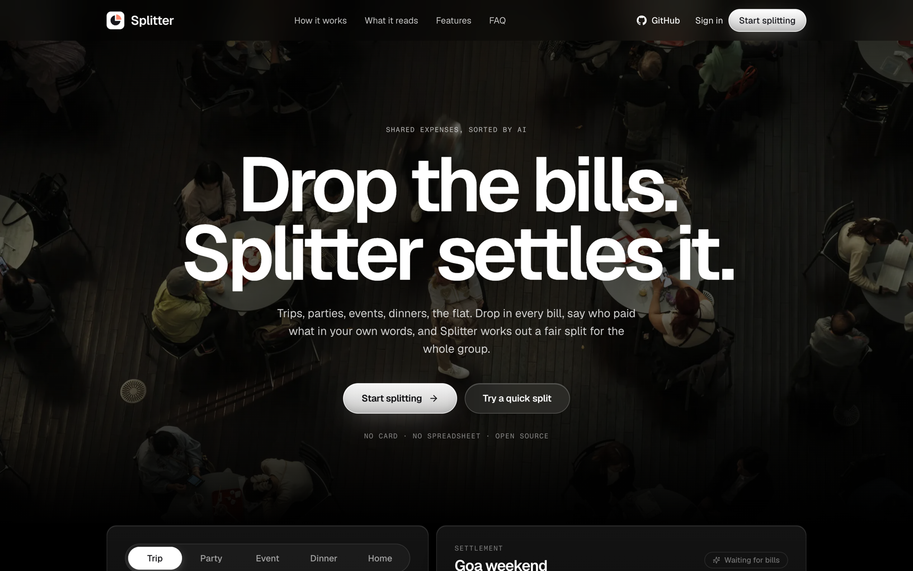
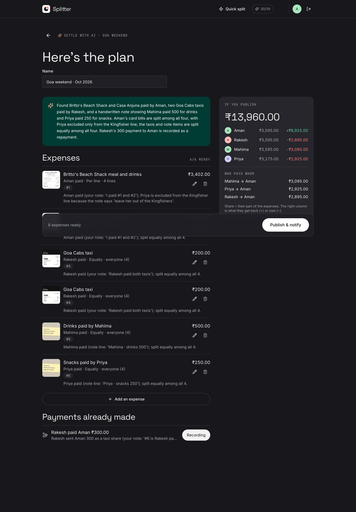
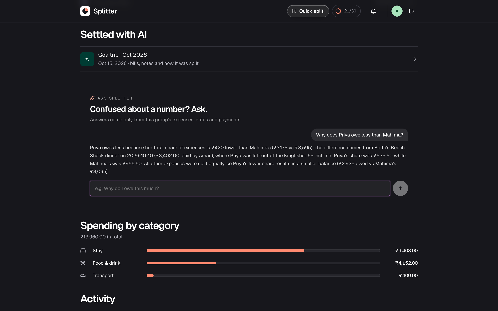
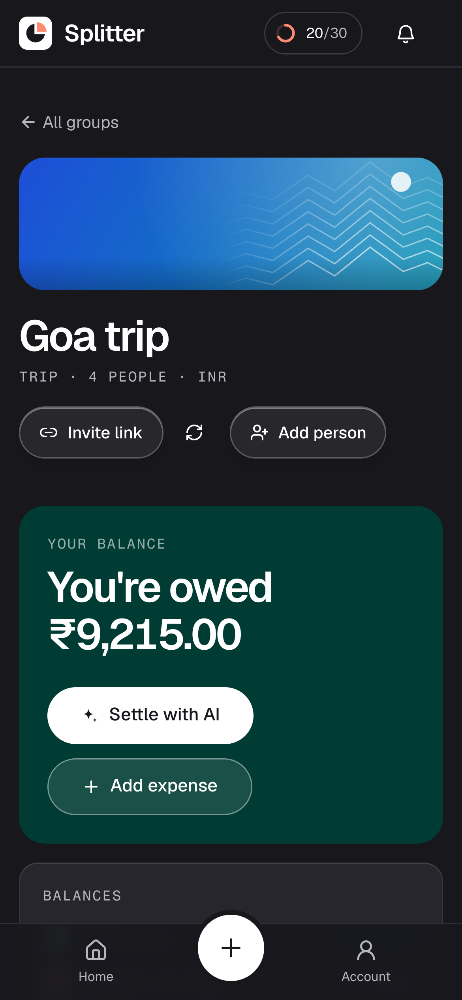
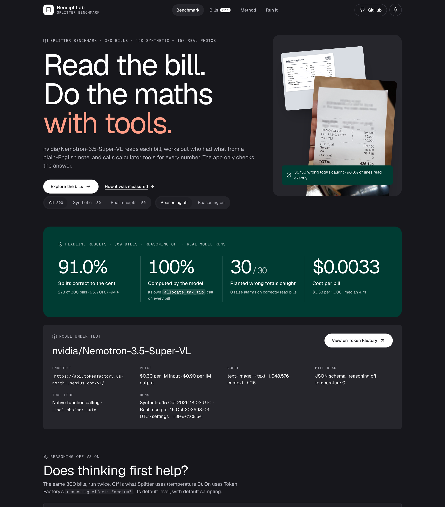

<div align="center">


# Splitter

### Drop the bills. Splitter settles it.

**Open-source shared expenses for trips, parties, events, dinners and the flat, powered by [`nvidia/Nemotron-3.5-Super-VL`](https://tokenfactory.nebius.com/?modals=endpoint-details&model-id=nvidia/Nemotron-3.5-Super-VL) on Nebius Token Factory. Drop in every bill, say who paid what in your own words, and Splitter works out a fair split for the whole group.**

Built with [Nebius Token Factory](https://dub.sh/aistudio) on **[Nemotron 3.5 Super VL](https://tokenfactory.nebius.com/?modals=endpoint-details&model-id=nvidia/Nemotron-3.5-Super-VL)** · [Get started](#get-started) · [Overview](#overview) · [Architecture](#architecture) · [Benchmark](#benchmark-receipt-lab) · [Features](#features) · [Data and privacy](#data-and-privacy)


[](https://tokenfactory.nebius.com/?modals=endpoint-details&model-id=nvidia/Nemotron-3.5-Super-VL)
[](https://dub.sh/aistudio)
[](./LICENSE)
[](https://studio1hq.com)

Run Splitter on your own machine with a [Nebius Token Factory](https://tokenfactory.nebius.com) API key for the model and a free [Novu](https://novu.co) account for notifications. The database is a local SQLite file.

</div>

---

<div align="center">

<table><tr><td>



</td></tr></table>

</div>

_The landing page demo cycles through a trip, a party, an event, a dinner and a flat. Every number in it is computed by the app's own split engine._

## Overview

Splitter is a group expense app built around one idea: the bills already know most of the answer. A vision model reads them, your group adds the context only people know ("Rakesh paid 200 twice, Priya didn't drink"), and the app turns both into balances everyone can check.

**A starting point you can run and extend.** Bring your own keys and host it yourself. The [Features](#features) section lists what's included.

### Settle with AI

Inside any group (trip, party, event, home, dinners), drop every bill at once: receipts, hotel invoices as PDFs, ride and payment screenshots, even a handwritten note. On a phone, scan bills one after another with the camera and tap **Done**. Then add a sentence about who paid what.

Splitter reads each bill, matches your notes, skips duplicates, turns payment screenshots into "paid back" entries and proposes one plan. You review and edit every expense before anything is saved, then **Publish & notify** sends each member their share.

<div align="center">

<table><tr><td>



</td></tr></table>

</div>

_Six uploads (a restaurant bill, a two-page hotel invoice, two cab receipts, a handwritten note and a UPI screenshot) become six expenses and one payment back. The model checked each bill and calculated every split with calculator tools; the two flags are real mismatches on the cab receipts._

### Context for everyone

Every batch keeps its bills, the group's original notes and a one-line explanation per expense. Members see the bill photos; anyone can open a read-only share link (names and amounts only; photos and notes only if you allow it).

**Ask Splitter** answers questions like "Why do I owe ₹2,895?" from that group's ledger only, citing the expenses behind the number.

<div align="center">

<table><tr><td>



</td></tr></table>

</div>

### Everyday splitting

- **One bill:** scan it (PDFs and multi-page bills work), tap who had each line, and tax and tip are shared by what each person ordered. "How this was checked" shows the calculator tool calls behind the result.
- **Just an amount (in a group):** split equally, by shares (a couple counts as 2) or by exact amounts.
- **Groups and balances:** add friends by name; they claim their spot with an invite link. Splitter suggests the fewest payments to settle up and can fill a payment from a screenshot. Each group gets a colour-and-artwork banner, and people can add a profile photo (visible only to people they share a group with).
- **Quick split:** scan one receipt and share the result, without making a group (free account required, since AI credits are per account).

<div align="center">

<table><tr><td>



</td></tr></table>

</div>

_Built for phones: bottom tab bar, bottom sheets, a camera scanner and safe-area insets._

## Architecture


**Two AI stages, calculator tools, one money engine.**

1. **Read each bill (vision).** The browser resizes photos and renders PDF pages, then each bill (up to 4 pages) is sent to `nvidia/Nemotron-3.5-Super-VL` with a JSON schema and reasoning off. It returns lines, tax, tip, fees, totals, a category, the document type and any "paid by" hint. Anything that isn't a bill is rejected.
2. **Plan the settlement (reasoning + tool calls).** The extracted bills, your notes, the members and recent expenses go to the same model with reasoning on and four calculator tools ([`src/server/ai/tools.ts`](src/server/ai/tools.ts)):
   - `check_receipt`: do the lines, tax, tip, fees and discount add up to the printed total?
   - `allocate_tax_tip`: who had which line, with charges spread proportionally;
   - `calculate_split`: equal, shares or exact amounts;
   - `validate_total`: do the shares add up to the total?

   The model decides who shares what and calls the tools for every number, then returns a draft plan: expenses with payer and split rule, payments already made, duplicates and questions. Every call is shown on the review screen under "How this was checked". If a model route doesn't support function calling, the app runs the same tools itself and says so.

The model does the maths, with tools: every share comes from a calculator tool the model calls, and the app checks the result. It re-runs any receipt check the model skipped and flags any split the model didn't calculate with a tool. `normalizePlan()` then checks every member, amount and exact split. On save, the server stores the shares in integer minor units with largest-remainder rounding, so balances always add up to the cent. Every group read and write goes through a membership check.

All provider-specific code lives in [`src/server/ai/nebius.ts`](src/server/ai/nebius.ts), behind an OpenAI-compatible client. To try another model, set `NEBIUS_MODEL` (and `NEXT_PUBLIC_AI_MODEL_LABEL` for the name shown in the UI), then run `pnpm smoke:nebius` to see whether it supports image input, strict JSON, tool calls and the reasoning switch. Set `AI_REASONING_PARAM=none` if it rejects `chat_template_kwargs.enable_thinking`.

```
src/
  app/                   Routes: landing, /split, /dashboard, /groups/[id] (+ /new, /batch, /batches/[id]), /s (share pages), /api
  components/batch/      Settle with AI: bill tray, review board, editor, normalizePlan()
  components/camera/     Multi-shot camera scanner
  components/split/      Single expense flow: receipt (or amount, in groups) → split → summary
  lib/money/             Money engine (pure, unit-tested)
  server/ai/             Nebius adapter, receipt schema, calculator tools, planner, Ask Splitter, credits
  server/services/       Groups, expenses, batches, bill images, settlements, access checks
  server/db/schema.ts    Drizzle schema
evals/                   Live accuracy evals with generated sample bills
```

## Get started

Use **Node.js 22+** and **pnpm**:

```sh
git clone https://github.com/Studio1-OSS/Splitter.git
cd Splitter
pnpm install
cp .env.example .env      # add NEBIUS_API_KEY, BETTER_AUTH_SECRET and the two Novu keys
pnpm db:migrate           # creates local.db (rerun whenever DATABASE_URL changes)
pnpm dev
```

Open **http://localhost:3000**. Generate the auth secret with `openssl rand -base64 32`.

| Variable | What it does |
| --- | --- |
| `NEBIUS_API_KEY` | **Required.** Bill reading, Settle with AI and Ask Splitter, via [Nebius Token Factory](https://tokenfactory.nebius.com). |
| `NEBIUS_MODEL` | Default [`nvidia/Nemotron-3.5-Super-VL`](https://tokenfactory.nebius.com/?modals=endpoint-details&model-id=nvidia/Nemotron-3.5-Super-VL). Check another model with `pnpm smoke:nebius --model <id>`. |
| `NEXT_PUBLIC_AI_MODEL_LABEL` | Model name shown in the UI (default `Nemotron 3.5 Super VL`). |
| `AI_REASONING_PARAM` | `chat_template_kwargs` (default: `enable_thinking` on/off) or `none`. |
| `NEBIUS_BASE_URL` | Default `https://api.tokenfactory.us-north1.nebius.com/v1/`. |
| `DATABASE_URL` | `file:local.db` locally, or `libsql://…` on [Turso](https://turso.tech). |
| `DATABASE_AUTH_TOKEN` | Turso only. |
| `BETTER_AUTH_SECRET` | Signs sessions ([Better Auth](https://www.better-auth.com)). Required. |
| `BETTER_AUTH_URL` | The app's URL, e.g. `http://localhost:3000`. Required (https) in production; Vercel preview deployments fall back to their own URL. |
| `AI_CREDITS_PER_USER_PER_DAY` | Daily AI allowance per account (default 30). |
| `NOVU_SECRET_KEY`, `NOVU_APP_ID` | **Required.** In-app and email notifications via [Novu](https://novu.co). Production won't start without them. |
| `NOVU_WORKFLOW_ID` | The Novu workflow to trigger (default `splitter-activity`). |

**Check your setup:**

```sh
pnpm smoke:nebius   # capability check: image input, strict JSON, tool calls, reasoning switch, one bill read
pnpm smoke:batch    # reads five sample bills and plans two settlements
```

### Keeping AI costs down

Every AI call spends daily credits from the signed-in account: reading a bill, a payment screenshot or answering a question costs 1, and a Settle-with-AI plan costs 3. When credits run out, manual entry still works, and they reset at midnight UTC. The account sheet shows what's left.

Measured on 300 benchmark bills, reading a bill and splitting it with tool calls uses about 9,200 input and 650 output tokens, which is about $0.0033 at Token Factory prices ($0.30 / $0.90 per 1M tokens). A Settle-with-AI plan with reasoning uses more. Photos are resized in the browser before upload, and an exact duplicate file isn't sent at all. Check current pricing on [Nebius Token Factory](https://tokenfactory.nebius.com).

### Notifications

1. Create a workflow in [Novu](https://novu.co) and put its identifier in `NOVU_WORKFLOW_ID`. Steps: **In-App** (subject `{{payload.title}}`, body `{{payload.body}}`, button to `{{payload.actionUrl}}`), then **Email** with the same title and body. Connect your own email provider (Resend, SendGrid, …) in Novu for production; Novu's built-in demo provider is for testing only.
2. Its template can use `{{payload.title}}`, `{{payload.body}}` and `{{payload.url}}`. For richer templates, these are also sent:
   - `billTitle`, `groupName`, `paidByName`;
   - `currency` (the symbol, e.g. `₹`);
   - `totalAmount` and `yourShare` (numbers);
   - `actionUrl`;
   - `{{subscriber.firstName}}`.
3. Copy the secret key and the Application Identifier into `.env`.
4. In production, turn on **HMAC** for the In-App integration. Splitter sends a `subscriberHash` so members can only read their own inbox.

Members are notified when an expense or a whole Settle-with-AI batch is published (with their own share), when a payment is recorded or confirmed, and when someone joins the group. Each event carries a stable `transactionId`, so retries never notify twice; a failed delivery is logged and never blocks saving.

### Deploy

1. Create a [Turso](https://turso.tech) database:
   ```sh
   turso db create splitter
   turso db show splitter --url
   turso db tokens create splitter
   ```
2. Run `DATABASE_URL=libsql://… DATABASE_AUTH_TOKEN=… pnpm db:migrate`.
3. Import the repo into [Vercel](https://vercel.com), set the variables above (with `BETTER_AUTH_URL` set to your domain for Production; leave it unset for Preview), and deploy. Use a separate `BETTER_AUTH_SECRET` per environment.

Vercel's Hobby plan is for non-commercial use. The live camera needs HTTPS, which Vercel provides.

### Tests and evals

```sh
pnpm test        # unit and service tests (money engine, plans, access, uploads)
pnpm typecheck
pnpm eval        # live accuracy against Nebius: bill reading and settlement planning
```

See [evals/README.md](evals/README.md) for the sample bills and how they're generated.

## Benchmark: Receipt Lab

[`benchmark/`](benchmark/README.md) is a reproducible benchmark of Splitter's core workflow, using the app's own code:
1. the model reads a bill image;
2. it decides who had what from a note;
3. it calls the calculator tools, and its own tool result is the split;
4. the app checks it with a validation rule.

It runs on 300 bills in two tracks: 150 synthetic bills (30 each of groceries, party, home & rent, food and travel, with planted wrong totals) and 150 real receipt photos from [CORD v2](benchmark/dataset/real/README.md). All are real model runs, with live Token Factory prices and 95% confidence intervals. A local dashboard shows every bill, tool call and miss.

| | All 300 | Synthetic 150 | Real 150 |
|---|---|---|---|
| Splits correct to the cent | 91.0% | 97.3% | 84.7% |
| …with reasoning on | 98.0% | 98.7% | 97.3% |
| 100 held-out real receipts (off / on) | | | 79.0% / 93.0% |
| …when the bill was read correctly | 98.1% | 99.3% | 96.7% |
| Split computed by the model's own tool call | 300/300 | 150/150 | 150/150 |
| Planted wrong totals caught | 30/30 | 30/30 | none planted |
| Cost per bill (reasoning off / on) | $0.0033 / $0.0057 | $0.0034 / $0.0056 | $0.0033 / $0.0058 |

The real track found a reading bug: the model took "60.000" rupiah for 60. A rule in Splitter's bill prompt fixed it (real-receipt splits went from 57.3% to 84.7% correct), and every user gets that fix. Splitter runs the model with reasoning off, which is about 3× faster; the benchmark also measures it with Token Factory's `reasoning_effort: "medium"`, which reads real photos far better. Details in [benchmark/README.md](benchmark/README.md#results).

```sh
pnpm bench:eval    # run the benchmark (about $1)
pnpm bench:dev     # open Receipt Lab on http://localhost:3001
```

Every deployment also serves Receipt Lab at `/benchmark`. `pnpm build` publishes the saved results there as static files, so it makes no model calls.



## Data and privacy

Groups, expenses, settlements and accounts are stored in SQLite: a local file, or Turso in production. Bill photos from Settle with AI and from "Add expense" in a group are kept as small compressed copies (about 150 KB) next to the expense. Only members of that group can open them, and they're deleted with the expense. Quick-split photos are never stored.

Nothing leaves your server except calls to the services you configure:

- **Nebius Token Factory** receives bill images and the text needed to plan or answer: extracted bills, your notes, member display names and the group's expenses.
- **Novu** receives each member's account id, display name, email address and the notification text.

Splitter sends no telemetry of its own. Public share links show display names and amounts, never emails or account ids. Bill photos and the group's notes appear on a share link only if someone in the group turns that on.

The benchmark ships 150 third-party receipt photos from CORD v2 (CC BY 4.0, credited in [`benchmark/dataset/real/`](benchmark/dataset/real/README.md)). The dataset authors had already blurred identifying details, and `/benchmark` serves them as public static files. No user data is part of the benchmark.

## Features

| Area | Included |
| --- | --- |
| Settle with AI | Many bills at once (photos, PDFs, screenshots, notes), multi-shot camera scanner, notes with name and bill chips, duplicate and not-a-bill detection, questions back to you, editable review board, one-tap publish |
| Bill reading | Receipts, invoices, tickets, payment screenshots, handwritten notes, any language; multi-page bills; checked against the printed total |
| Splits | Per line, equally, by shares or exact amounts; tax, tip and fees shared by what each person had; any currency |
| Groups | Trip, party, event, home, dinners; banners; invite links that let friends claim their name; spending by category; members-only profile photos |
| Settle up | Fewest-payments suggestions, payments recorded and confirmed, fill from a payment screenshot |
| Context | Batch pages with bills and notes, public share links, Ask Splitter |
| Limits | Daily AI credits per account (AI features need a free account) |
| Notifications | Novu in-app inbox plus an instant email: expenses and batches with each member's share, payments recorded and confirmed, new members |
| Design | Phone-first, dark mode, one token-based design system (`src/app/globals.css`); self-hosted Geist and Fragment Mono fonts (SIL OFL) |

### Extending it

- Multiple payers on one expense, and recurring household expenses.
- Edit a published expense, with a history.
- WhatsApp or SMS notifications through Novu channels.
- Currency conversion for trips abroad.

---

Building on open models? **[Join the Nebius builder program](https://dub.sh/aistudio)** for credits and support.

MIT License · Built by the [Studio1 team](https://studio1hq.com)
