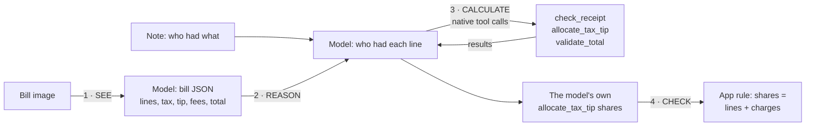

# Receipt Lab: bill → verified split with Nemotron 3.5 Super VL

A benchmark, with runnable code, for a reproducible **visual-document workflow**:
1. the model **inspects a bill image** and extracts it;
2. it **reasons** about who had what from a plain-English note;
3. it **calls calculator tools** for every number, and its own tool result is the split.

The app then checks that answer with a validation rule. Every number below comes from real model runs on 150 synthetic bills.

**Tested model:** [`nvidia/Nemotron-3.5-Super-VL`](https://tokenfactory.nebius.com/?modals=endpoint-details&model-id=nvidia/Nemotron-3.5-Super-VL) on Nebius Token Factory.
- **Endpoint:** `https://api.tokenfactory.us-north1.nebius.com/v1/`
- **Input:** text and image; context about 1M tokens; bf16.
- **Price:** $0.30 per 1M input tokens and $0.90 per 1M output tokens, read live from `GET /v1/models?verbose=true`.

The benchmark lives inside [Splitter](https://github.com/Studio1-OSS/Splitter), an open-source app for splitting shared costs. It reuses the app's own model adapter, bill schema and calculator tools rather than copies of them.


## Walkthrough



1. **See.** The bill image goes to the model with Splitter's bill schema (strict JSON, reasoning off, temperature 0). It returns every line, the tax, tip, service charge, discount and printed total.
2. **Reason.** The model gets the lines, the people (as `m1`, `m2`…) and a note such as *"Aman and Priya shared the Cappuccino, everyone shared the Croissant"*.
3. **Calculate.** Through native function calling, the model calls:

   | Tool | Does |
   |---|---|
   | `check_receipt` | Do the lines, tax, tip, fees and discount add up to the printed total? |
   | `allocate_tax_tip` | Splits the bill by who had which line; charges are spread in proportion. Integer minor units, largest-remainder rounding, ties by group order. |
   | `validate_total` | Do the shares add up to the total? |

   The split is **the model's own last `allocate_tax_tip` result**. The app never computes one for it: if the model doesn't call the tool, the bill counts as wrong.
4. **Check.** One validation rule from the app: the model's shares must add up to what the bill's lines and charges come to. If `check_receipt` failed and the model reported the problem, the bill is flagged.

Example (`party-01`, a bill whose printed total is wrong on purpose):

```
1 · SEE (2.1s) — CONFETTI PARTY STORE · 3 lines · printed total 24568 INR
2/3 · REASON + CALCULATE (2.7s)
  ✗ model:check_receipt({"bill":1})
      → "Everything adds up to 24468.00 but the printed total is 24568.00."
  ✓ model:allocate_tax_tip({"bill":1,"lines":[{"line":1,"members":["m1","m2"]},{"line":2,"members":["m2"]},{"line":3,"members":["m1","m2"]}]})
      → {"total":24468,"shares":{"m1":10506.66,"m2":13961.34}}
  ✓ model:validate_total(…) → {"ok":true,"sharesSum":24468,"diff":0}
  ✓ app:validate_total(…)   ← the validation rule
⚠ Bill issues the model reported: Everything adds up to 24468.00 but the printed total is 24568.00.
The model's split: { Aman: 10506.66, Priya: 13961.34 }
```

In Receipt Lab, every bill shows its image, what the model read next to the truth, and each tool call with its arguments and result:


## Setup and code

```bash
git clone https://github.com/Studio1-OSS/Splitter && cd Splitter
pnpm install
cp .env.example .env                 # add NEBIUS_API_KEY (tokenfactory.nebius.com)

pnpm bench:agent benchmark/dataset/party-01.png \
  "Everyone shared the DJ booking 3h, Priya had the Sparkling wine x2, everyone shared the Birthday cake 2kg." \
  Aman,Priya                          # one bill, full trace

pnpm bench:eval                   # the 150-bill benchmark (about $0.50, about 3 minutes)
pnpm bench:eval --limit 10        # or a quick sample; also --category travel, --concurrency N
pnpm bench:eval --report          # rebuild results.md and this README's results from results.json
pnpm bench:dev                    # Receipt Lab on http://localhost:3001 (reads saved results, no model calls)
pnpm bench:dataset                # regenerate the 150 bills (needs Chrome)
```

| File | What it is |
|---|---|
| [`receipt-agent.mts`](receipt-agent.mts) | The agent: see → reason → calculate → check |
| [`eval.mts`](eval.mts) | The benchmark runner and scoring |
| [`stats.mts`](stats.mts) | Live prices from Token Factory, Wilson intervals |
| [`dataset/`](dataset) | 150 bills plus `cases.json` (the ground truth) and the generator |
| [`server.mts`](server.mts), [`web/`](web) | The Receipt Lab dashboard (local only) |
| [`../src/server/ai/tools.ts`](../src/server/ai/tools.ts) | The calculator tools (shared with the app) |
| [`../src/server/ai/nebius.ts`](../src/server/ai/nebius.ts) | Model adapter and tool-calling loop (shared with the app) |

## Results

The benchmark writes this section from `results.json`, the same file the dashboard reads. Method: [METHODOLOGY.md](METHODOLOGY.md).

<!-- results:start -->
2026-10-15T16:00:58.167Z · 150 synthetic bills · endpoint `https://api.tokenfactory.us-north1.nebius.com/v1/` · settings `d0e4f725edc8`
Application-level evaluation on synthetic data, not an official benchmark. Method: [METHODOLOGY.md](METHODOLOGY.md).

| Metric | Result |
|---|---|
| Runs completed | 100.0% (150/150, 95% CI 98–100%) |
| Line prices read exactly | 99.4% (843/848, 95% CI 99–100%) |
| Line names + prices read | 96.0% (814/848, 95% CI 94–97%) |
| Printed total read | 100.0% (150/150, 95% CI 98–100%) |
| Tax read | 99.3% (149/150, 95% CI 96–100%) |
| Split computed by the model (tool call) | 100.0% (150/150, 95% CI 98–100%) |
| Model's split correct to the cent (all bills) | 95.3% (143/150, 95% CI 91–98%) |
| … on bills without a planted error | 94.2% (113/120, 95% CI 88–97%) |
| App validation rule passed | 100.0% (150/150, 95% CI 98–100%) |
| Bill read completely (every line, charge and total) | 96.0% (144/150, 95% CI 92–98%) |
| Split correct when the bill was read correctly | 98.6% (142/144, 95% CI 95–100%) |
| Planted wrong totals caught | 100.0% (30/30, 95% CI 89–100%) |
| False alarms (flag on a correctly read, correct bill) | 0.0% (0/114, 95% CI 0–3%) |
| Misreads on correct bills flagged by check_receipt | 83.3% (5/6, 95% CI 44–97%) |
| Latency per bill (p50 / p95) | 5.1s / 6.5s |
| Tokens per bill (in / out) | 8924 / 730 |
| Cost | $0.5001 total · $0.00333 per bill · $3.33 per 1,000 bills |
| Network retries | 0 |

Prices: $0.3/1M input, $0.9/1M output tokens (GET /v1/models?verbose=true on 2026-10-15).

## By category

| Category | Bills | Lines priced | Total read | Split correct | Planted caught | False alarms |
|---|---|---|---|---|---|---|
| food | 30 | 100.0% | 30/30 | 29/30 | 6/6 | 0/24 |
| groceries | 30 | 100.0% | 30/30 | 29/30 | 6/6 | 0/23 |
| home | 30 | 98.3% | 30/30 | 28/30 | 6/6 | 0/21 |
| party | 30 | 99.4% | 30/30 | 29/30 | 6/6 | 0/23 |
| travel | 30 | 99.4% | 30/30 | 28/30 | 6/6 | 0/23 |
<!-- results:end -->

**Reading the numbers:**
- **Every split came from the model's own tool call,** on all 150 bills. The app's validation rule passed on all of them.
- **Reasoning is strong.** When the bill had been read correctly, the model's split was right to the cent on 142 of 144 bills.
- **Most remaining errors are reading errors,** and they cluster on rotated A4 invoices. Rotated photos had 25 of 30 splits right; clean ones had 59 of 60. In a misread, the model usually took a price from the neighbouring row, and `check_receipt` then flagged 5 of the 6 misreads, because the numbers stopped adding up.
- **Planted wrong totals:** caught on all 30, spread across every currency, layout and photo condition, with no false alarms on correctly read bills.
- **Reproducible:** a second full run agreed with this one on every one of the 150 bills.

## Limitations

- **Synthetic bills.** They're clean renders with simulated fading and rotation. Real photos, with glare, folds, crumples and handwriting, are harder, so measure on your own bills before relying on the numbers.
- **Unambiguous notes.** Each line name is unique and the note names everyone. Real "who had what" is messier, and Splitter shows every assignment for review before saving.
- **Arithmetic, not intent.** The tools check sums; they can't tell that a line went to the wrong person, and such a split still adds up. The two reasoning misses were of this kind.
- **Scope.** This lab measures image understanding, reasoning and tool calls on bills. It makes no claims about other tasks, computer use or browser control.
- **One model, one endpoint, one date.** The results apply to the settings shown, which are recorded in `results.json` as a settings fingerprint.
