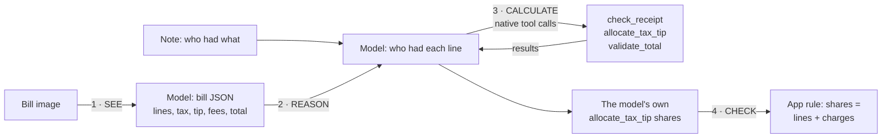
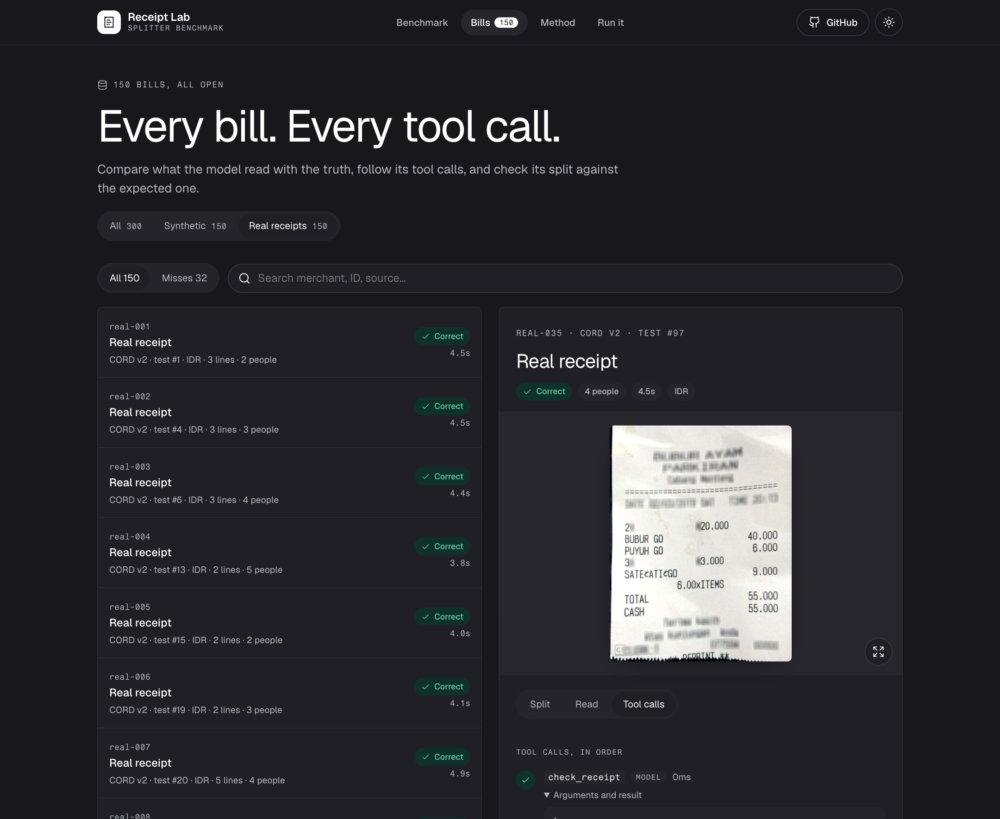

# Receipt Lab: bill → verified split with Nemotron 3.5 Super VL

A benchmark, with runnable code, for a reproducible **visual-document workflow**:
1. the model **inspects a bill image** and extracts it;
2. it **reasons** about who had what from a plain-English note;
3. it **calls calculator tools** for every number, and its own tool result is the split.

The app then checks that answer with a validation rule. Every number below comes from real model runs on 300 bills, in two tracks:

- **Synthetic:** 150 rendered bills (groceries, party, home & rent, food, travel; INR, USD, EUR), balanced on every axis, with 30 planted wrong totals.
- **Real receipts:** 150 photographed restaurant and café receipts from [CORD v2](dataset/real/README.md) (Indonesia, rupiah, CC BY 4.0), with the dataset's human labels as ground truth.

**Tested model:** [`nvidia/Nemotron-3.5-Super-VL`](https://tokenfactory.nebius.com/?modals=endpoint-details&model-id=nvidia/Nemotron-3.5-Super-VL) on Nebius Token Factory.
- **Endpoint:** `https://api.tokenfactory.us-north1.nebius.com/v1/`
- **Input:** text and image; context about 1M tokens; bf16.
- **Price:** $0.30 per 1M input tokens and $0.90 per 1M output tokens, read live from `GET /v1/models?verbose=true`.

The benchmark lives inside [Splitter](https://github.com/Studio1-OSS/Splitter), an open-source app for splitting shared costs. It reuses the app's own model adapter, bill schema and calculator tools rather than copies of them.


## Walkthrough



1. **See.** The bill image goes to the model with Splitter's bill schema (strict JSON, reasoning off, temperature 0). It returns every line, the tax, tip, service charge, discount and printed total.
2. **Reason.** The model gets the lines, the people (as `m1`, `m2`…) and a note such as *"Aman and Priya shared the Cappuccino, everyone shared the Croissant"*.
3. **Calculate.** Through native function calling, the model calls:

   | Tool | Does |
   |---|---|
   | `check_receipt` | Do the lines, tax, tip, fees and discount add up to the printed total? |
   | `allocate_tax_tip` | Splits the bill by who had which line; charges are spread in proportion. Integer minor units, largest-remainder rounding, ties by group order. |
   | `validate_total` | Do the shares add up to the total? |

   The split is **the model's own last `allocate_tax_tip` result**. The app never computes one for it: if the model doesn't call the tool, the bill counts as wrong.
4. **Check.** One validation rule from the app: the model's shares must add up to what the bill's lines and charges come to. If `check_receipt` failed and the model reported the problem, the bill is flagged.

Example (`party-01`, a bill whose printed total is wrong on purpose):

```
1 · SEE (2.1s) — CONFETTI PARTY STORE · 3 lines · printed total 24568 INR
2/3 · REASON + CALCULATE (2.7s)
  ✗ model:check_receipt({"bill":1})
      → "Everything adds up to 24468.00 but the printed total is 24568.00."
  ✓ model:allocate_tax_tip({"bill":1,"lines":[{"line":1,"members":["m1","m2"]},{"line":2,"members":["m2"]},{"line":3,"members":["m1","m2"]}]})
      → {"total":24468,"shares":{"m1":10506.66,"m2":13961.34}}
  ✓ model:validate_total(…) → {"ok":true,"sharesSum":24468,"diff":0}
  ✓ app:validate_total(…)   ← the validation rule
⚠ Bill issues the model reported: Everything adds up to 24468.00 but the printed total is 24568.00.
The model's split: { Aman: 10506.66, Priya: 13961.34 }
```

In Receipt Lab, every bill shows its image, what the model read next to the truth, and each tool call with its arguments and result:



## Setup and code

```bash
git clone https://github.com/Studio1-OSS/Splitter && cd Splitter
pnpm install
cp .env.example .env                 # add NEBIUS_API_KEY (tokenfactory.nebius.com)

pnpm bench:agent benchmark/dataset/party-01.png \
  "Everyone shared the DJ booking 3h, Priya had the Sparkling wine x2, everyone shared the Birthday cake 2kg." \
  Aman,Priya                          # one bill, full trace

pnpm bench:eval                   # both tracks, 300 bills (about $1)
pnpm bench:eval --set real        # one track (--set synthetic / real); the other's saved results are kept
pnpm bench:eval --limit 10        # or a quick sample; also --category travel, --concurrency N
pnpm bench:eval --report          # rebuild results.md and this README's results from results.json
pnpm bench:dev                    # Receipt Lab on http://localhost:3001 (reads saved results, no model calls)
pnpm bench:publish                # static copy in public/benchmark/ (also runs in pnpm build → /benchmark)
pnpm bench:dataset                # regenerate the 150 synthetic bills (needs Chrome)
pnpm bench:import-real            # re-import the 150 CORD v2 receipts (Python with pyarrow + pillow)
```

| File | What it is |
|---|---|
| [`receipt-agent.mts`](receipt-agent.mts) | The agent: see → reason → calculate → check |
| [`eval.mts`](eval.mts) | The benchmark runner and scoring |
| [`stats.mts`](stats.mts) | Live prices from Token Factory, Wilson intervals |
| [`dataset/`](dataset) | 150 synthetic bills plus `cases.json` (the ground truth) and the generator |
| [`dataset/real/`](dataset/real) | 150 CORD v2 receipt photos, their `cases.json`, the importer's output and the licence |
| [`server.mts`](server.mts), [`web/`](web) | The Receipt Lab dashboard (local only) |
| [`../src/server/ai/tools.ts`](../src/server/ai/tools.ts) | The calculator tools (shared with the app) |
| [`../src/server/ai/nebius.ts`](../src/server/ai/nebius.ts) | Model adapter and tool-calling loop (shared with the app) |

## Results

The benchmark writes this section from `results.json`, the same file the dashboard reads. Method: [METHODOLOGY.md](METHODOLOGY.md).

<!-- results:start -->
300 bills · endpoint `https://api.tokenfactory.us-north1.nebius.com/v1/` · synthetic: 2026-10-15T18:03:47.362Z · settings `fc90e0730ee6` · real: 2026-10-15T18:03:47.362Z · settings `fc90e0730ee6`
Application-level evaluation, not an official benchmark. Real receipts: CORD v2 (CC BY 4.0). Method: [METHODOLOGY.md](METHODOLOGY.md).

| Metric | All 300 | Synthetic 150 | Real 150 |
|---|---|---|---|
| Runs completed | 100.0% (300/300) | 100.0% (150/150) | 100.0% (150/150) |
| Model's split correct to the cent | 91.0% (273/300, 95% CI 87–94%) | 97.3% (146/150, 95% CI 93–99%) | 84.7% (127/150, 95% CI 78–90%) |
| Split computed by the model (tool call) | 100.0% (300/300) | 100.0% (150/150) | 100.0% (150/150) |
| Bill read completely (every line, charge and total) | 89.3% (268/300) | 97.3% (146/150) | 81.3% (122/150) |
| Split correct when the bill was read correctly | 98.1% (263/268) | 99.3% (145/146) | 96.7% (118/122) |
| Line prices read exactly | 98.8% (1309/1325) | 99.4% (843/848) | 97.7% (466/477) |
| Line names + prices read | 94.0% (1245/1325) | 96.1% (815/848) | 90.1% (430/477) |
| Printed total read | 99.7% (299/300) | 100.0% (150/150) | 99.3% (149/150) |
| Tax read | 95.3% (286/300) | 99.3% (149/150) | 91.3% (137/150) |
| App validation rule passed | 100.0% (300/300) | 100.0% (150/150) | 100.0% (150/150) |
| Planted wrong totals caught | 100.0% (30/30) | 100.0% (30/30) | n/a (none planted) |
| False alarms (flag on a correctly read, correct bill) | 0.0% (0/238) | 0.0% (0/116) | 0.0% (0/122) |
| Misreads on correct bills flagged by check_receipt | 65.6% (21/32) | 75.0% (3/4) | 64.3% (18/28) |
| Latency per bill (p50 / p95) | 4.7s / 6.7s | 5.0s / 6.7s | 4.5s / 5.8s |
| Tokens per bill (in / out) | 9162 / 649 | 9122 / 732 | 9203 / 567 |
| Cost per bill | $0.00333 | $0.00340 | $0.00327 |
| Cost per 1,000 bills | $3.33 | $3.40 | $3.27 |
| Network retries | 0 | 0 | 0 |

Prices: $0.3/1M input, $0.9/1M output tokens (GET /v1/models?verbose=true on 2026-10-15).

## Synthetic bills by category

| Category | Bills | Lines priced | Total read | Split correct | Planted caught | False alarms |
|---|---|---|---|---|---|---|
| food | 30 | 100.0% | 30/30 | 29/30 | 6/6 | 0/24 |
| groceries | 30 | 100.0% | 30/30 | 30/30 | 6/6 | 0/24 |
| home | 30 | 98.3% | 30/30 | 29/30 | 6/6 | 0/22 |
| party | 30 | 99.4% | 30/30 | 29/30 | 6/6 | 0/23 |
| travel | 30 | 99.4% | 30/30 | 29/30 | 6/6 | 0/23 |
<!-- results:end -->

**Reading the numbers:**
- **Every split came from the model's own tool call,** on all 300 bills, and the app's validation rule passed on all of them.
- **Reasoning is strong on both tracks.** When the bill had been read correctly, the split was right to the cent on 145 of 146 synthetic bills and 118 of 122 real receipts.
- **Real photos are harder to read.** 81.3% of real receipts were read completely, against 97.3% of synthetic bills. What's left: a line missed or a coupon read as a discount, and tax missed or swapped with the service charge. On 8 receipts the model also listed free lines (sauces, bags) that CORD doesn't label; those don't change any amount, and 9 misread receipts still got the right split.
- **One prompt rule fixed the biggest real-photo error.** In the first real-receipt run, the model read "60.000" and "60,000" rupiah as 60 on 44 of 150 receipts, so every amount was 1,000× too small. `check_receipt` couldn't see it, because a bill scaled down evenly still adds up. Splitter's bill prompt now says how to read thousands separators; that error fell to 1 receipt, and real-receipt splits went from 57.3% to 84.7% correct. Both tracks were rerun with the new prompt, and no synthetic bill got worse (146 correct, up from 143).
- **On synthetic bills, misreads cluster on A4 invoices:** all 4 were invoices, 3 of them rotated. `check_receipt` flagged 3 of the 4.
- **Planted wrong totals:** caught on all 30, spread across every currency, layout and photo condition, with no false alarms on any correctly read bill in either track.

## Limitations

- **Synthetic bills** are clean renders with simulated fading and rotation. The real track shows how much harder photos are.
- **The real track is narrow:** Indonesian restaurant and café receipts in one currency, with no planted errors. Receipts from other countries, long invoices and handwriting aren't covered. Measure on your own bills before relying on the numbers.
- **Generated, unambiguous notes.** On both tracks, who had what is generated, each line name is unique and the note names everyone. Real "who had what" is messier, and Splitter shows every assignment for review before saving.
- **Arithmetic, not intent.** The tools check sums; they can't tell that a line went to the wrong person, and such a split still adds up. The 5 reasoning misses were of this kind.
- **Scope.** This lab measures image understanding, reasoning and tool calls on bills. It makes no claims about other tasks, computer use or browser control.
- **One model, one endpoint, one date.** The results apply to the settings shown, which are recorded in `results.json` as a settings fingerprint.
